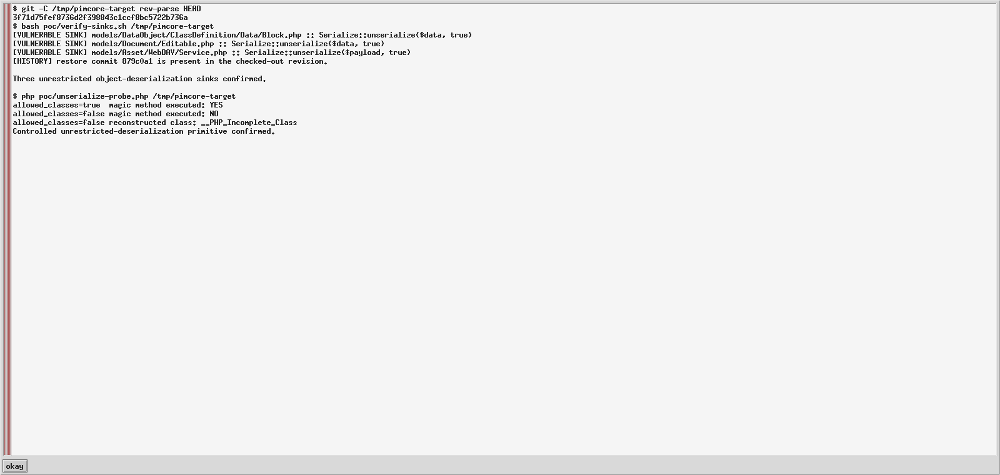
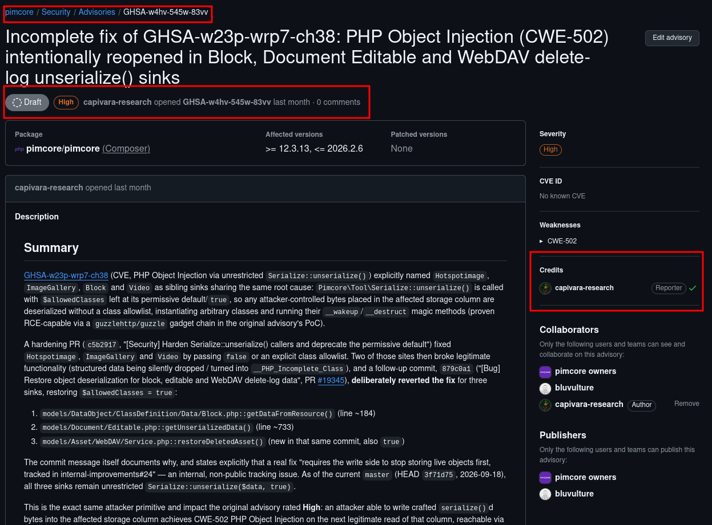

# GHSA-w4hv-545w-83vv

## Pimcore incomplete PHP Object Injection fix in Block, Document Editable and WebDAV delete-log sinks

Public research reference for the security report privately submitted to the Pimcore maintainers through GitHub Security Advisories.

- Advisory: [GHSA-w4hv-545w-83vv](https://github.com/pimcore/pimcore/security/advisories/GHSA-w4hv-545w-83vv)
- Related original advisory: [GHSA-w23p-wrp7-ch38](https://github.com/pimcore/pimcore/security/advisories/GHSA-w23p-wrp7-ch38)
- Product repository: [`pimcore/pimcore`](https://github.com/pimcore/pimcore)
- Affected package: `pimcore/pimcore`
- Affected versions: `>= 12.3.13, <= 2026.2.6`
- Weakness: CWE-502 — Deserialization of Untrusted Data
- Severity: High
- CVE status: No CVE assigned to this report
- Researcher credit: **Fernando Viana - Capivara Research**

## Verification evidence

The screenshot below is a direct capture of both PoCs in this repository running against audited Pimcore commit `3f71d75fef8736d2f398843c1ccf8bc5722b736a`.

The first command confirms the three production calls to `Serialize::unserialize(..., true)` and the presence of restore commit `879c0a1`. The second command uses a benign local marker class and demonstrates the security boundary:

- `allowed_classes=true`: PHP reconstructs the class and executes `__wakeup()`;
- `allowed_classes=false`: the magic method does not execute and PHP returns `__PHP_Incomplete_Class`;
- no command-execution gadget or remote target is used.

This proves the unrestricted-deserialization primitive and the behavior of the boolean control. It does not, by itself, claim a complete remote delivery/write primitive for every sink.

## Technical targets

| Sink | Affected file and function | Attacker-controlled persisted value |
|---|---|---|
| DataObject Block | `models/DataObject/ClassDefinition/Data/Block.php::getDataFromResource()` | Block resource column passed as `$data` |
| Document Editable | `models/Document/Editable.php::getUnserializedData()` | `documents_elements.data` |
| WebDAV delete log | `models/Asset/WebDAV/Service.php::restoreDeletedAsset()` | Serialized payload in `webdav-delete.dat` |

All three reach `Pimcore\Tool\Serialize::unserialize(..., true)`, enabling unrestricted PHP class reconstruction before any return-value shape check can run. Audited revision: `3f71d75fef8736d2f398843c1ccf8bc5722b736a`.

## Exploitability and scoring boundary

The supplied PoC proves unrestricted object reconstruction and magic-method execution with a benign local marker. A complete remote attack additionally requires a route, privilege, or separate vulnerability that writes crafted serialized bytes into one of the persisted values above. Because that delivery primitive is not demonstrated uniformly for all three sinks, this repository does not publish a standalone CVSS vector that would imply an unproven remote attack path. The private advisory records the issue as High and CWE-502; the related original advisory documents an RCE-capable dependency gadget chain.

## Submission evidence

The screenshot below records the private GitHub Security Advisory, affected versions, severity, weakness classification and reporter attribution.

## Disclosure note

This repository documents the existence, scope and attribution of the report. The report concerns an incomplete security fix and additional PHP object-deserialization sinks in Block, Document Editable and WebDAV delete-log handling. Detailed coordination and remediation remain with the vendor through the advisory linked above.

## Reproduction material

The [`poc/`](./poc/) directory contains a source verifier for all three affected sinks and a controlled PHP probe demonstrating the difference between unrestricted and disabled class reconstruction. The documented exploitability boundary distinguishes the proven deserialization primitive from the additional write primitive required for a remote attack.

## Recommended remediation

- Stop storing live PHP object graphs and migrate the affected values to a non-executable representation.
- If native serialization must remain temporarily, authenticate each blob with a server-side integrity key and reject modified or unsigned values before deserialization.
- Add regression tests proving that modified persistence data cannot instantiate arbitrary classes or invoke magic methods.
- Publish or update an advisory because `Block` was named as fixed by the related advisory but was later reopened, while the Editable and WebDAV sinks were not previously tracked there.

## References

- [Pimcore product repository](https://github.com/pimcore/pimcore)
- [Private report GHSA-w4hv-545w-83vv](https://github.com/pimcore/pimcore/security/advisories/GHSA-w4hv-545w-83vv)
- [Related original advisory GHSA-w23p-wrp7-ch38](https://github.com/pimcore/pimcore/security/advisories/GHSA-w23p-wrp7-ch38)
- [CWE-502](https://cwe.mitre.org/data/definitions/502.html)
